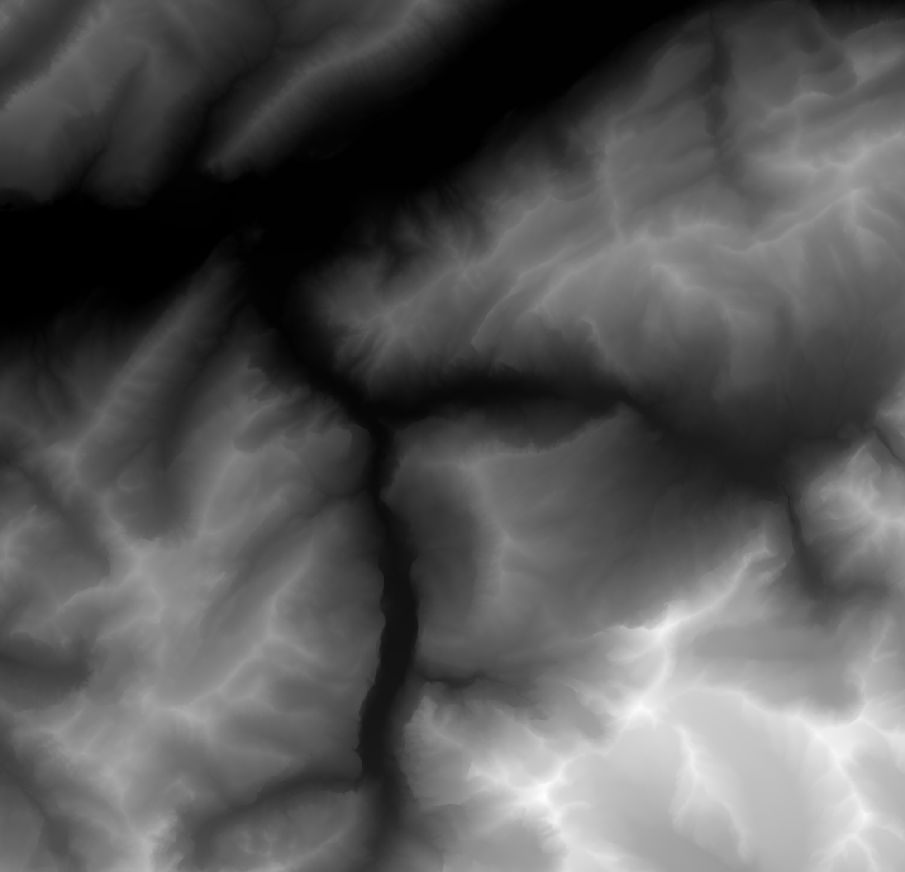
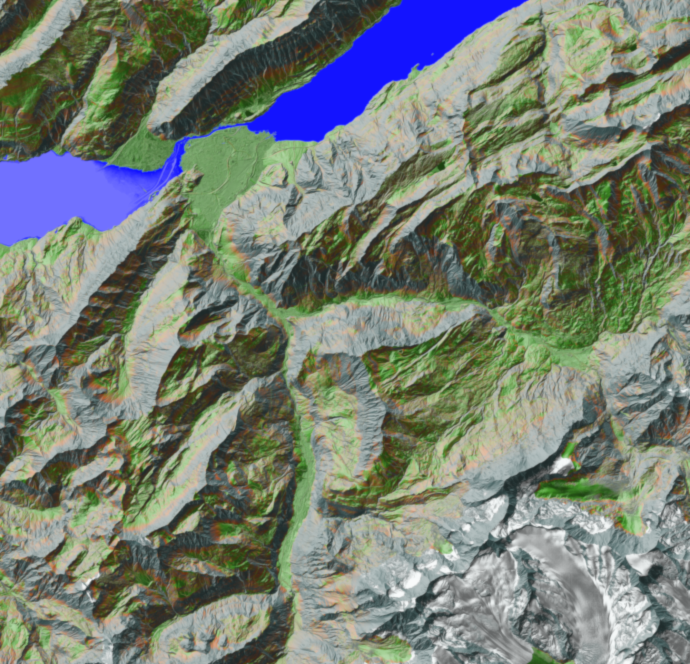
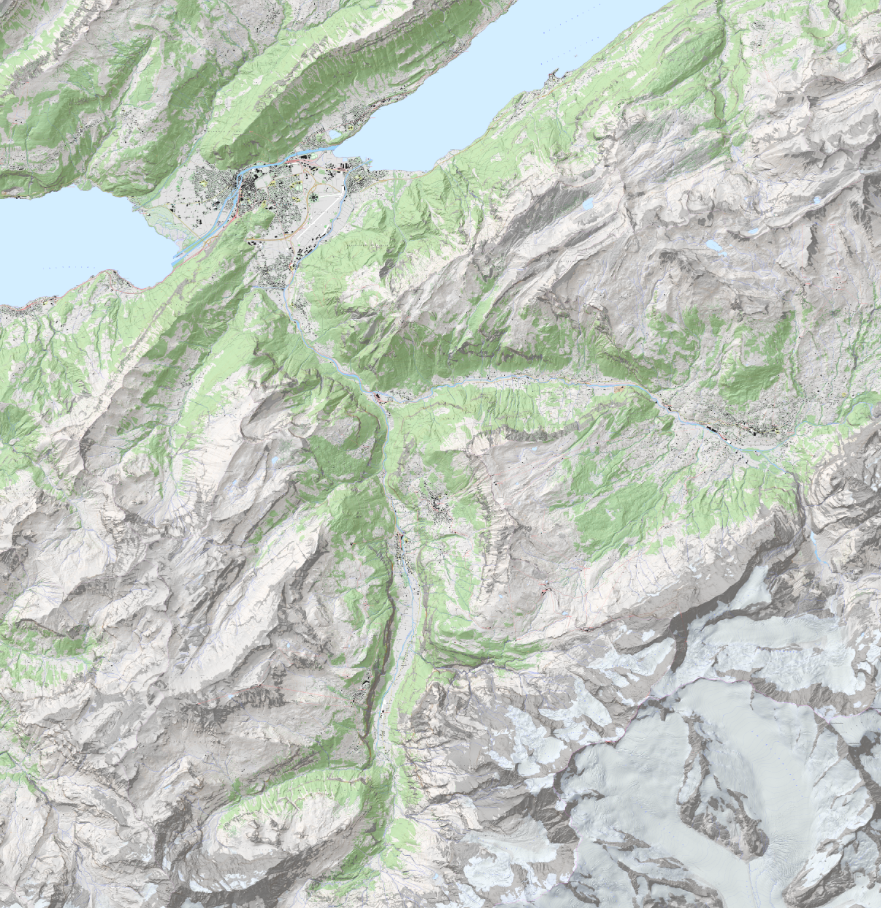

# Haskape
HEIG-VD - PLP 2026 - Raphaël Perret

Haskape generates colorful aerial views of terrain from a digital elevation model.

Terrain altitude around Interlaken


Aerial View generated by the program


Color map of roughly the same area


## Usage
Haskape needs at least some input image and an output file name
```bash
haskape zermatt-dem.jpeg zermatt-aerial.jpeg
```

We may specify many parameters such as
- grass-color : hexadecimal color code
- stone-color
- water-color
- snow-color
- forest-color

- water-level : altitude of water surface
- snow-level : altitude of snow
- rock-slope
- min-forest-slope
- max-forest-slope

## How it works
We define a set of layers and rules to determine which layer to use for a given pixel.
A layer is defined as an altitude range and slope range. Each pixel value is directly its altitude, and the difference in altitude with its neighbors is the pixel slope.

So if pixel is a two dimensional array of floating point altitude values:
altitude(i,j) = pixel[i][j]
slope(i,j) = (pixel[i-1][j] - pixel[i][j],pixel[i][j-1] - pixel[i][j-1])

The slope is a vector and its size and orientation allows us to shade the terrain. This process is called hillshading and takes a few parameters, such as the sun position (defaults to the top left corner, the cartography convention).

## Data preparation
The exemples all use Swisstopo's SwissAlti3d digital elevation model, with a precision of two meters per pixel. It provides a set of cloud optimised geotiff files covering Switzerland, that are then referenced in a gdal virtual dataset. This then allows us to create a simple image in jpeg or png format of any area we want, given the coordinates of upper left and bottom right corners.

```bash
# construct the virtual dataset from all geotiff tiles
ls | grep "*.tif" > tiles.txt && gdal raster mosaic tiles.txt swissalti3d.vrt && rm tiles.txt

# clip virtual dataset to desired area
gdal raster clip --bbox 2625189,1151996,2650125,1176025 swissalti3d.vrt interlaken.vrt

# get minimum and maximum altitude stats for region
gdal raster info interlaken.vrt | grep -E "MINIMUM|MAXIMUM"

# convert to a single image
gdal raster pipeline ! read interlaken.vrt ! scale --ot UInt16 ! write ../interlaken.png

# we don't neet to keep the intermediate virtual dataset
rm interlaken.vrt
```

Gdal uses format-specific drivers to export images. PNG only supports 8 bits or 16 bits values, JPEG 8 or 12 bits. I will be using these formats for the sake of simplicity, but this implies the addition of two parameters for min and max values. This will allow our program to map integers of any size to a range of float.

## Limitations
The only base information is the elevation data. That is insufficient to accurately guess where water streams and lakes are. Giving a fixed altitude range does not work very well in this example because lake Thun and lake Brienz are quite a few meters appart, with sharp drop in altitude in the city of interlaken. Therefore parts of the city is below the surface of lake Brienz and appears blue. There is also no real way of knowing if we are looking at buildings, roads, forest or anything. An interesting addition would be to also take land use data, but then altitude is mostly there to provide shading.